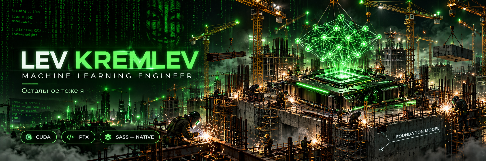

# Lev Kremlev

### Machine Learning Engineer · Research Scientist · AI Architect · MLOps Engineer · Остальное тоже я

Разрабатываю интеллектуальные системы полного цикла: от постановки задачи до объяснения, почему метрика на проде отличается.

Специализируюсь на Computer Vision, Natural Language Processing, Multimodal Learning, Generative AI, Reinforcement Learning и других направлениях, для которых уже вышла библиотека.

---

## About me

- Строю scalable, robust, efficient, interpretable, trustworthy и иногда работающие AI-системы.

- Превращаю state-of-the-art research в state-of-the-art технический долг.

- Читаю papers, воспроизвожу результаты, принимаю расхождения.

- Работаю на стыке науки, инженерии и нехватки видеопамяти.

- Открыт к интересным задачам, исследовательским коллаборациям и свободным GPU.


## Technical Expertise

| Направление                | Технологии и компетенции                                                                                                                                       |
| -------------------------- | -------------------------------------------------------------------------------------------------------------------------------------------------------------- |
| **Classical ML**           | Linear / Logistic Regression, SVM, kNN, Naive Bayes, Decision Trees, Random Forest, Extra Trees, XGBoost, LightGBM, CatBoost, осторожный подбор `random_state` |
| **Deep Learning**          | MLP, CNN, RNN, LSTM, GRU, TCN, Transformers, GNN, MoE, SSM, Mamba, архитектуры из приложений к статье                                                          |
| **Computer Vision**        | Classification, Detection, Segmentation, Tracking, OCR, Pose Estimation, Depth Estimation, Optical Flow, SLAM, NeRF, Gaussian Splatting, зрительный контакт    |
| **NLP**                    | Tokenization, Embeddings, NER, POS, Parsing, Sentiment Analysis, Translation, Summarization, QA, NLI, понимание формулировки заказчика                         |
| **Large Language Models**  | Pretraining, SFT, LoRA, QLoRA, PEFT, DPO, PPO, GRPO, RLHF, RLAIF, instruction following, уверенное продолжение списка                                          |
| **LLM Inference**          | KV Cache, PagedAttention, FlashAttention, Continuous Batching, Speculative Decoding, Prefix Caching, Tensor / Pipeline Parallelism, ожидание своей очереди     |
| **Quantization**           | FP32, TF32, BF16, FP16, FP8, INT8, INT4, GPTQ, AWQ, GGUF, округление ожиданий                                                                                  |
| **Generative AI**          | GAN, VAE, VQ-VAE, Diffusion, Flow Matching, Rectified Flow, Autoregressive Models, генерация дополнительных требований                                         |
| **Multimodal AI**          | CLIP, VLM, VLA, Image-Text, Audio-Text, Video-Language, объединение несовместимых форматов данных                                                              |
| **Speech & Audio**         | ASR, TTS, VAD, Diarization, Source Separation, Codec Models, подавление шума на созвонах                                                                       |
| **Reinforcement Learning** | Q-Learning, DQN, A2C, A3C, PPO, SAC, TD3, Offline RL, Reward Modeling, обучение на последствиях                                                                |
| **Graph ML**               | GCN, GAT, GraphSAGE, Node2Vec, Link Prediction, Knowledge Graphs, связи через знакомых                                                                         |
| **Time Series**            | ARIMA, SARIMA, Prophet, N-BEATS, TFT, PatchTST, прогноз сроков с доверительным интервалом в квартал                                                            |
| **Recommendation Systems** | Collaborative Filtering, Matrix Factorization, Two-Tower, Ranking, Re-ranking, рекомендация увеличить бюджет                                                   |
| **Causal Inference**       | DAG, ATE, CATE, Propensity Score, Double ML, установление причин падения сервиса                                                                               |
| **Probabilistic ML**       | Bayesian Inference, MCMC, Variational Inference, Gaussian Processes, распределение ответственности                                                             |
| **Optimization**           | SGD, Adam, AdamW, Lion, L-BFGS, Bayesian Optimization, оптимизация количества экспериментов перед дедлайном                                                    |
| **Data Engineering**       | SQL, Spark, Kafka, Airflow, dbt, ETL / ELT, Parquet, Arrow, DuckDB, файлы `final_final_2.csv`                                                                  |
| **MLOps**                  | MLflow, W&B, DVC, Docker, Kubernetes, Kubeflow, Ray, BentoML, Triton, перенос ноутбука в другую папку                                                          |
| **Evaluation**             | Accuracy, Precision, Recall, F1, ROC-AUC, PR-AUC, BLEU, ROUGE, WER, CER, mAP, IoU, NDCG, выбор наиболее убедительной                                           |
| **Responsible AI**         | Fairness, Explainability, Privacy, Robustness, Safety, Model Cards, ответственное использование слова «готово»                                                 |
| **Distributed Training**   | DDP, FSDP, DeepSpeed, ZeRO, NCCL, All-Reduce, распределённое выяснение, кто занял GPU                                                                          |
| **GPU Engineering**        | CUDA, cuDNN, cuBLAS, Triton, TensorRT, ONNX, Nsight, укладка тензоров в ограниченный объём                                                                     |
| **Systems Engineering**    | Linux, Bash, Git, CI/CD, Networking, Storage, охлаждение, электропитание                                                                                       |
| **Applied Engineering**    | Пайка, сварка, токарная обработка, фрезеровка, восстановление геометрии датасета                                                                               |
| **Infrastructure**         | Бетонирование, армирование, монтаж несущих конструкций, горизонтальное масштабирование здания                                                                  |
| **Foundation Models**      | Ленточный, свайный, плитный; выбор основания в зависимости от нагрузки                                                                                         |
## Programming Languages

|Language|Proficiency|
|---|---|
|Python|Advanced|
|C++|Advanced|
|CUDA C++|Advanced|
|Triton|Expert|
|PTX|Fluent|
|SASS|Native|
## Languages

Russian — Native · English — C4 · Arabic — A1

## Impact at a whitespace

| Initiative | Engineering outcome | Validation |
| --- | --- | --- |
| Whitespace Engineering | Внедрил пробел между двумя словами. | Слова разделяют решение. |
| Continuous Delivery | Доставил изменение в README. | README получил изменение. |
| Release Management | Перенёс строку. | Миграция прошла без потери букв. |

## Projects & Achievements

| Project | What I did | Result |
| --- | --- | --- |
| [Extent](https://github.com/KremlevLev/extent) | Заменил Qwen большую часть attention на Mamba-3. | Теперь у обоих дефицит внимания. |
| Architecture Recovery | Восстанавливаю качество после собственных архитектурных улучшений. | Создал себе рабочее место. |
| Knowledge Distillation | Организовал передачу знаний от teacher к student. | Родителей вызвали на TPU. |
| [Hugging Face](https://huggingface.co/datasets/levkremlev888/extent) | Опубликовал экспериментальные артефакты. | Тысячи скачиваний. Люди забирают результаты моих экспериментов добровольно. 3.5к+ |

## Selected achievements

- Довёл исследовательский прототип до production. Исследователи до сих пор ищут.

- Уменьшил latency на 43%, затем уточнил единицы измерения.

- Воспроизвёл результаты статьи с точностью до отсутствующих исходников.

- Настроил distributed training на нескольких GPU, машинах и часовых поясах.

- Построил end-to-end pipeline. Теперь любой сбой действительно проходит его целиком.

- Устранил data leakage переносом тестовой выборки в папку, о которой никто не знает.

- Добился reproducibility: эксперимент стабильно требует повторного запуска.

- Внедрил human-in-the-loop. Human пока не вышел.

- Вывел модель на новый уровень обобщения: теперь она ошибается и на знакомых задачах.

- Заложил фундамент для масштабирования. Бетон набирает прочность.


## Research interests

Efficient Deep Learning · Representation Learning · Self-Supervised Learning · Continual Learning · Active Learning · Meta-Learning · Transfer Learning · Federated Learning · Test-Time Adaptation · World Models · Embodied AI · Neuro-Symbolic AI · AI for Science · Science for AI · AI for AI · Learning to Learn · Learning to Stop Learning and Finally Deploy

## Current focus

```
model.train()
model.eval()
model.train()  # появились новые обстоятельства
```

## Profile Analytics

<p align="center">
  
  
  
</p>

<table>
  <tr>
    <th>GitHub Performance</th>
    <th>Contribution Consistency</th>
  </tr>
  <tr>
    <td width="50%">
      
    </td>
    <td width="50%">
      
    </td>
  </tr>
  <tr>
    <th colspan="2">Engineering Activity Overview</th>
  </tr>
  <tr>
    <td colspan="2">
      
    </td>
  </tr>
  <tr>
    <th>Language Distribution</th>
    <th>Language Distribution — Compact View</th>
  </tr>
  <tr>
    <td>
      
    </td>
    <td>
      
    </td>
  </tr>
  <tr>
    <th>Language Distribution — Circular View</th>
    <th>Language Distribution — Alternative Circular View</th>
  </tr>
  <tr>
    <td>
      
    </td>
    <td>
      
    </td>
  </tr>
  <tr>
    <th>Repository Language Composition</th>
    <th>Commit Language Composition</th>
  </tr>
  <tr>
    <td>
      
    </td>
    <td>
      
    </td>
  </tr>
  <tr>
    <th>Cross-Validated GitHub Statistics</th>
    <th>Temporal Productivity Distribution</th>
  </tr>
  <tr>
    <td>
      
    </td>
    <td>
      
    </td>
  </tr>
  <tr>
    <th colspan="2">Contribution Dynamics</th>
  </tr>
  <tr>
    <td colspan="2">
      
    </td>
  </tr>
  <tr>
    <th colspan="2">Professional Recognition</th>
  </tr>
  <tr>
    <td colspan="2" align="center">
      
    </td>
  </tr>
</table>

<p align="center">
  <sub>Independent Verification of Profile Traffic</sub><br />
  
</p>

<p align="center">
  <sub>Для объективной оценки инженерных компетенций рекомендуется ознакомиться со всеми диаграммами.</sub>
</p>
